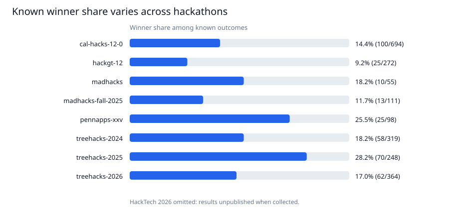
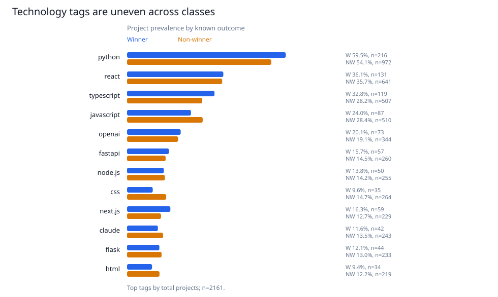
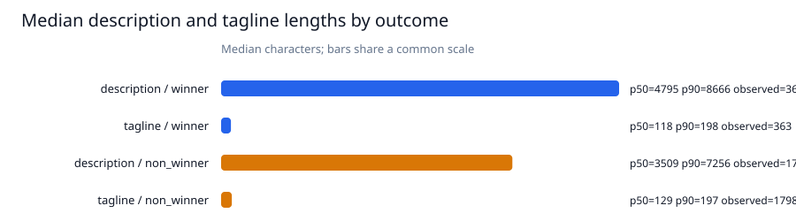
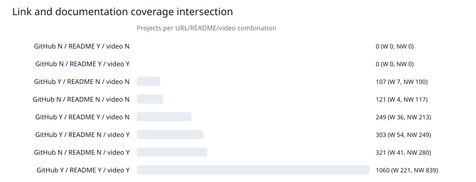

# Data Quality Enrichment + EDA: Hackathon ML Research

**Дата:** 2026-11-10T16:59:51+00:00<br>
**Источник:** [twangodev/devpost-hacks](https://huggingface.co/datasets/twangodev/devpost-hacks), pinned revision `3cb29f15841c7b61fd78a20ff12127e0846dc227`.<br>
**Unit:** один Devpost project; исходные строки не изменялись. HackTech 2026 исключён из target, потому что источник сообщает, что результатов ещё не было при сборе.

## Ключевые числа

- В pinned cache: **2222** строк; аналитическая таблица с known outcomes: **2161** проектов = **363 winners + 1798 non-winners**; **61** withheld/unknown строк, в том числе 61 HackTech 2026.
- README: raw `readmes` record присутствует у **1358** строк; usable embedded README (repo identifier и непустой content в одной записи) — у **1354**. **[CONFIRMED]** Четыре raw records не проходят этот usability filter; breakdown: no non-empty content: 4. **[INFERRED]** Совпадение 1 358 raw records с числом dataset card правдоподобно объясняет 1 358 против 1 354; точное правило card **[UNKNOWN]**.
- В known-outcome таблице: GitHub URL в `other_links` **1719/2161 (79.5%)**; непустой README **1309/2161 (60.6%)**; video URL **1684/2161 (77.9%)**; все три одновременно **1060/2161 (49.1%)**.
- Подвыборка GitHub URL + непустое README: **1309** projects (**257 winner / 1052 non-winner**; winner share 19.6%). Это кандидаты на дальнейший analysis subset, но доступность GitHub и пред-event timing не доказываются наличием ссылки/README.

## README discrepancy

**[CONFIRMED]** В pinned cache 1 358 строк имеют непустой `readmes` list, а 1 354 — хотя бы одну запись одновременно с repo identifier и непустым README content; разница — 4. Невалидные records распределены так: no non-empty content: 4. **[INFERRED]** Dataset card, вероятно, считает raw records, но его точное правило **[UNKNOWN]**; исходные данные не менялись.

## Результаты по событиям

Доли рассчитаны только среди known outcomes. Различия между мероприятиями — описательные, не причинные.

| Hackathon | N | Winners | Non-winners | Winner share | GitHub URL | README content | Video URL | All three |
|---|---:|---:|---:|---:|---:|---:|---:|---:|
| cal-hacks-12-0 | 694 | 100 | 594 | 14.4% | 466 | 351 | 622 | 322 |
| hackgt-12 | 272 | 25 | 247 | 9.2% | 217 | 170 | 234 | 154 |
| madhacks | 55 | 10 | 45 | 18.2% | 50 | 32 | 16 | 11 |
| madhacks-fall-2025 | 111 | 13 | 98 | 11.7% | 94 | 77 | 49 | 34 |
| pennapps-xxv | 98 | 25 | 73 | 25.5% | 78 | 63 | 79 | 57 |
| treehacks-2024 | 319 | 58 | 261 | 18.2% | 267 | 192 | 164 | 106 |
| treehacks-2025 | 248 | 70 | 178 | 28.2% | 233 | 184 | 213 | 162 |
| treehacks-2026 | 364 | 62 | 302 | 17.0% | 314 | 240 | 307 | 214 |

Самая низкая/высокая доля winner среди учтённых events: `hackgt-12` (9.2%) и `treehacks-2025` (28.2%). Технические теги и ссылки также различаются между events; это может отражать разные задачи, правила, submission patterns и состав участников.



## Technologies и текстовая длина

Технологии нормализованы через `strip().casefold()` и считаются не более одного раза на проект. Распространённость — доля проектов в каждом классе, не доля среди всех тегов.

| Technology | Projects | Winners using | Non-winners using | Winner prevalence | Non-winner prevalence |
|---|---:|---:|---:|---:|---:|
| python | 1188 | 216 | 972 | 59.5% | 54.1% |
| react | 772 | 131 | 641 | 36.1% | 35.7% |
| typescript | 626 | 119 | 507 | 32.8% | 28.2% |
| javascript | 597 | 87 | 510 | 24.0% | 28.4% |
| openai | 417 | 73 | 344 | 20.1% | 19.1% |
| fastapi | 317 | 57 | 260 | 15.7% | 14.5% |
| node.js | 305 | 50 | 255 | 13.8% | 14.2% |
| css | 299 | 35 | 264 | 9.6% | 14.7% |
| next.js | 288 | 59 | 229 | 16.3% | 12.7% |
| claude | 285 | 42 | 243 | 11.6% | 13.5% |

Среднее количество `built_with` тегов: winners **9.26**, non-winners **7.98**; подробное распределение лежит в `../results/eda/eda_technology_count_distribution.csv`.



Длины измерены в Unicode characters и whitespace-delimited words; это не semantic quality. Median description length: winners **4795 chars** (p90 8666), non-winners **3509 chars** (p90 7256); median tagline: winners **118**, non-winners **129 chars**. Missing/blank values исключены из статистики: description **0/2161**, tagline **0/2161**. Распределения асимметричны; mean/median не следует интерпретировать как качество.



## GitHub, README, video и limited link check

Presence в snapshot отличается от текущей HTTP-доступности. В known subset: GitHub URL 1719; непустой README 1309; video URL 1684. Таблица ниже показывает пересечение всех восьми комбинаций.

| GitHub URL | README content | Video URL | Projects | Winners | Non-winners |
|---|---|---|---:|---:|---:|
| N | N | N | 121 | 4 | 117 |
| N | N | Y | 321 | 41 | 280 |
| N | Y | N | 0 | 0 | 0 |
| N | Y | Y | 0 | 0 | 0 |
| Y | N | N | 107 | 7 | 100 |
| Y | N | Y | 303 | 54 | 249 |
| Y | Y | N | 249 | 36 | 213 |
| Y | Y | Y | 1060 | 221 | 839 |



Limited check: детерминированно выбрано **16** projects (по одному winner и non-winner на каждый из восьми eligible events); для каждого было проверено не более одной GitHub URL и одной video URL — **21** однократных `HEAD` запросов максимум. Пауза 1.0s, timeout 15s, без retries, авторизации, обхода anti-bot, repository cloning или video download. Link status cache хранит individual project IDs/URLs только под `../data/raw/` (ignored, не публиковать).

| Link type | HTTP/network status | Checks |
|---|---|---:|
| github | http_200 | 10 |
| github | http_404 | 1 |
| video | http_200 | 10 |

`403` — доступ запрещён; `405` — HEAD не поддержан; `429` — rate-limited; ошибки сети/timeout — ресурс не классифицирован. Никакие из этих ответов не меняют snapshot presence. HEAD `2xx` говорит только, что URL отвечал на момент проверки, а не что repo содержимое качественно/доступно для структурного парсинга. UNKNOWN statuses не трактуются как dead URLs.

## Потенциальные признаки и leakage

Лексический screening title/tagline/description выявил award/winner-подобные слова у **102/2161** проектов, а embedded README — у **72/2161**. Это индикаторы ручного контроля, не label verification и не доказательство утечки. `results` и `is_winner` — target/source of label, не X.

| Сигнал | Момент доступности | Для pre-end baseline? |
|---|---|---|
| `project_id` | Snapshot; это ключ | Нет: только identifier |
| `hackathon` | Известно как group ID | Нет как predictor; использовать для group split |
| `built_with` / count / one-hot | Timestamp отсутствует | Пока нет; только retrospective EDA |
| Description/tagline lengths/text | Timestamp отсутствует; возможны post-event edits | Нет до cutoff audit; prose содержит outcome-style terms |
| GitHub URL / README / video presence | Timestamp отсутствует; submission material мог быть добавлен после результата | Нет до подтверждения temporal availability |
| `results` / `is_winner` | Outcome поле | Target only; исключить из X |
| Текущий HTTP status | Измерен после snapshot | Нет; volatile future state |

Полный feature inventory с dtype/missing/leakage/disposition — `../results/eda/eda_feature_inventory.csv`. По структуре dataset нет явного timestamp на поля проекта, поэтому из этой выгрузки нельзя доказать доступность feature до окончания хакатона. Любой baseline здесь должен быть помечен как retrospective association/prediction-on-snapshot, если не будет найден point-in-time snapshot.

## Структурная подвыборка и решение

GitHub URL + непустой embedded README дает **1309** known projects: 257 winners и 1052 non-winners, по событиям распределено следующим образом (таблица `../results/eda/eda_github_readme_by_event.csv`). Объём выглядит достаточным для следующего **feature-extraction pilot** без массовой загрузки репозиториев, но частичный README coverage может быть selection-biased. Перед сравнениями A vs A+B нужно сравнивать A на том же subset, зафиксировать критерии отбора и проверить local/pinned README usability. `available README` не подтверждает, что связанный GitHub repository всё ещё публичен.

## Ограничения и неизвестное

- Независимая outcome spot-check остаётся неподтверждённой: предыдущая ограниченная проверка Devpost получила HTTP 403.
- HTTP check в данном этапе ограничен 21 URLs; он не оценивает общую долю доступных repos/videos.
- Нет timestamps, judging criteria, contest-level metadata/prize pool, temporal snapshots и стабильного мерила качества.
- Event differences, prevalence и text length — descriptive; никаких причинных выводов.
- Модели не обучались.

## Воспроизведение

Python 3.10+; стандартная библиотека, без установки зависимостей.

```bash
python scripts/data_quality_eda.py
```

Скрипт использует existing pinned cache из `../data/raw/`, пишет row-level table без описаний/URLs в ignored `../data/processed/`, агрегаты и SVG-графики в `../results/eda/`. External link checks ограничены 16 projects/максимум 32 URL; результаты сохраняются в ignored `../data/raw/`. `--refresh-link-checks` повторяет ограниченную проверку. `--skip-link-checks` не отправляет запросы: использует individual cache, а если его нет — существующую агрегированную сводку; индивидуальные данные не восстанавливаются.
